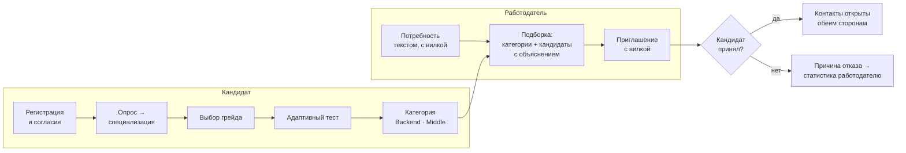

# ITScout

**ITScout** — платформа ИТ-подбора с обратной механикой для спецтрека ФСП хакатона «Лидеры цифровой трансформации 2026». Кандидат проходит опрос и адаптивный тест и получает категорию «специализация × грейд». Работодатель описывает потребность, получает подборку кандидатов с объяснением и сам отправляет приглашение с обязательной вилкой зарплаты. Контакты кандидата открываются только после того, как он принял приглашение или откликнулся сам.

- Прототип: **https://itscout.ru** (вход в кабинеты — кнопками демо-входа на странице входа)
- Swagger UI: https://itscout.ru/api/docs, контракт — [`backend/openapi.json`](backend/openapi.json)
- Документация одним файлом: [`docs/ITScout-docs.pdf`](docs/ITScout-docs.pdf)
- Лицензия: MIT

## Как это работает



1. **Категорию определяет тест, а не резюме.** Банк из 523 параметризованных шаблонов на общей IRT-шкале, двухэтапный адаптивный тест, оценка способности EAP и решение о грейде по порогам.
2. **Подборка объяснима.** Score и объяснение считаются одним кодом из одних и тех же компонентов: категория, проверенные навыки, сила результата теста, ФСП, свежесть, условия.
3. **ФСП — бонус, а не штраф.** Достижения из реестра ФСП (мок) поднимают кандидата в выдаче и подтверждают компетенции. Профиль без ФСП полностью работоспособен.
4. **Собственная валидация.** Симуляция на 2 000 кандидатах через тот же движок: категория совпадает с истинным грейдом у 82% (ошибка больше чем на грейд — 0%), при утечке 30% ключей доля ложно прошедших растёт на 1 п.п. против 56 п.п. у фиксированного теста; категория по тесту как фильтр подбора даёт P@5 0,75 против 0,28 у поиска по ключевым словам резюме.

## Демо-доступы

| Роль | Как войти | Что посмотреть |
|---|---|---|
| Кандидат Анна Ковалёва (Backend · Middle, есть ФСП) | «Вход» → блок «Демо-вход» → «Кандидат» | категория и разбор по темам, приглашения с «почему вам», вакансии, задания, привязка ФСП ID |
| Работодатель «Демо Банк» | «Вход» → «Демо-вход» → «Работодатель» | потребности, подборка с объяснением, шорт-лист, приглашения, «Проверка под вакансию» |
| Новый пользователь | «Регистрация» | весь путь кандидата с нуля: опрос → тест → категория |
| Участник ФСП в мок-IdP | кнопка «Войти через ФСП ID» в настройках кандидата | логины — в `infra/keycloak/fsp-realm.json` и [docs/fsp-integration.md](docs/fsp-integration.md) |

## Документация

Обязательные разделы сопроводительной документации (п. 3.4 ТЗ):

| Пункт ТЗ | Документ |
|---|---|
| Функциональная и компонентная архитектура | [docs/architecture.md](docs/architecture.md) |
| Механика тестирования и устойчивость к распространению заданий | [docs/testing.md](docs/testing.md) |
| Механика подбора и логика категоризации | [docs/matching.md](docs/matching.md) |
| Процедура валидации и её результаты | [docs/validation.md](docs/validation.md), полный отчёт — [docs/validation/report.md](docs/validation/report.md) |
| Схема интеграции с реестром ФСП | [docs/fsp-integration.md](docs/fsp-integration.md) |
| Описание API | [docs/api.md](docs/api.md), справочник эндпоинтов — [docs/api-endpoints.md](docs/api-endpoints.md) |
| Библиотеки и компоненты с версиями | [docs/versions.md](docs/versions.md) |
| Сборка, развёртывание и локальный запуск | [docs/deploy.md](docs/deploy.md) |

Дополнительно: [безопасность и 152-ФЗ](docs/security.md), [концепция защиты от фиктивных вакансий и интеграции с ATS](docs/anti-fraud-ats.md), [нагрузочное тестирование](docs/performance.md), [исследование и план улучшений](docs/research/README.md), [ограничения и планы](docs/limitations.md). ТЗ на реализацию для команды и агентов — [docs/implementation.md](docs/implementation.md).

## Быстрый старт

```bash
git clone https://github.com/bojlahg/FSP_ITVacancyAggregator.git itscout && cd itscout
cp .env.example .env            # задать POSTGRES_PASSWORD и KEYCLOAK_ADMIN_PASSWORD, см. docs/deploy.md
docker compose --env-file .env -f infra/docker-compose.yml up -d --build
docker compose --env-file .env -f infra/docker-compose.yml exec backend python -m seed.generate
# → http://localhost
```

Подробно, в том числе режим разработки и запуск без Docker, — в [docs/deploy.md](docs/deploy.md).

## Стек

Python 3.12, FastAPI, SQLAlchemy 2 (async), Alembic, numpy/scipy · PostgreSQL 16 · React 19, Vite, TypeScript, TanStack Query, Tailwind · Caddy, Docker Compose, GitHub Actions · Keycloak 26 (мок ФСП ID) · Yandex AI Studio (опционально) · pytest, Playwright.

## Структура репозитория

```text
backend/        FastAPI-монолит: app/modules/<модуль>, content/ (YAML-справочники и банк заданий), migrations/, seed/, tests/
fsp-mock/       мок реестра ФСП — отдельный сервис с API-ключом
frontend/       SPA на React: кабинеты кандидата и работодателя
validation/     симуляционная валидация → docs/validation/
e2e/            Playwright: демо-сценарий против прода
infra/          docker-compose, Caddyfile, Keycloak realm «fsp»
docs/           документация, отчёт валидации, сборка PDF (docs/pdf/)
```
