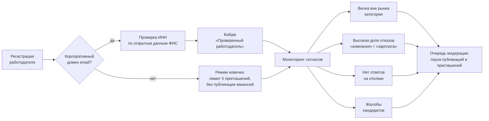
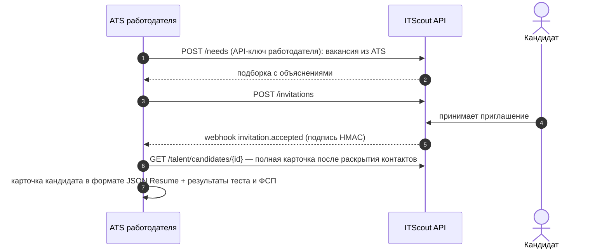

# Защита от фиктивных вакансий и интеграция с ATS

По ТЗ верификация работодателей и модерация вакансий в MVP не требуются, а проработанная концепция защиты и интеграции с ATS даёт дополнительные баллы. Ниже — что уже работает в прототипе и как механизм развивается дальше.

## 1. Защита от фиктивных вакансий и недобросовестных работодателей

### 1.1. Угрозы

| Угроза | Чем вредит |
|---|---|
| Фиктивная вакансия — сбор резюме и контактов, «прощупывание рынка» | кандидат раскрывает данные, предложения нет |
| Нереальная вилка — завышенная, чтобы привлечь, или «от 30 000» | кандидат тратит время на собеседования |
| Массовая рассылка приглашений | спам, обесценивание приглашения |
| Сбор контактов под видом работодателя | утечка ПДн |
| Исчезновение после отклика | плохой опыт кандидата |

### 1.2. Что уже есть в MVP

| Механизм | Как работает |
|---|---|
| Вилка обязательна | в потребности, вакансии и приглашении: проверка в схеме API и CHECK в БД; кандидат видит условия до начала общения |
| Контакты только по согласию кандидата | работодатель получает контакты лишь после принятия приглашения или отклика самого кандидата; каждое раскрытие пишется в аудит |
| Лимит активных приглашений | не больше 15 на потребность по всей цепочке версий; правка потребности не обнуляет счётчик |
| Одно активное приглашение одному кандидату | повторное приглашение — только после ответа, отзыва или истечения срока |
| Срок жизни приглашения | 14 дней, затем `expired` |
| Репутация работодателя для кандидата | число приглашений, доля принятых, доля отозванных, медиана времени ответа на отклики — видны кандидату рядом с приглашением |
| Вилка против рынка | вилка сравнивается с ожиданиями кандидатов категории: «ниже рынка» (покрывает меньше 20% ожиданий) и «подозрительно высокая» (нижняя граница вдвое выше медианы — типичная приманка). Работодатель видит вердикт при работе с потребностью, кандидат — пометку в приглашении |
| Причины отказов | кандидат выбирает причину (зарплата, стек, формат, компания, не ищу), работодатель видит агрегат — системный сигнал о нереальной вилке |
| Скрытие от компаний | кандидат может скрыть профиль от выбранных работодателей |

### 1.3. Развитие после MVP



1. **Верификация компании:** подтверждение корпоративного домена email, проверка ИНН и статуса юрлица через открытые данные ФНС (поле ИНН в профиле компании уже есть), сверка домена сайта с доменом почты.
2. **Проверка вилки на адекватность** уже работает как предупреждение (раздел 1.2). Следующий шаг — сделать её частью модерации: повторяющиеся «подозрительно высокие» вилки отправляют компанию в очередь проверки.
3. **Рейтинг по поведению:** репутация из 1.2 превращается в score работодателя; низкий score снижает лимиты и отправляет компанию в очередь модерации.
4. **Жалобы кандидатов** на приглашение («фейковая вакансия», «другие условия на собеседовании») с порогом автоматической паузы.
5. **Режим новичка:** новые компании без верификации получают уменьшенные лимиты приглашений и не публикуют вакансии.
6. **Бейдж «Проверенный работодатель»** в приглашении и списке вакансий.

## 2. Интеграция с ATS

Работодатели уже ведут кандидатов в ATS (Huntflow, Talantix, Potok и др.). ITScout не заменяет ATS, а становится источником кандидатов с подтверждённым уровнем.



| Элемент | Как устроено |
|---|---|
| API-ключи работодателя | **работают**: выпускаются в профиле компании («Интеграция с ATS»), ключ показывается один раз, в БД — только SHA-256; заголовок `X-API-Key` даёт тот же REST API и OpenAPI-контракт, что использует фронт, с теми же правилами видимости; управлять ключами и webhook по ключу нельзя |
| Исходящие webhook'и | **работают**: `invitation.accepted`, `invitation.declined`, `application.created` и тестовый `ping`; подпись `X-ITScout-Signature: t=…,v1=HMAC-SHA256(secret, "t.тело")`; outbox в БД, повторы через 30 с, 5 мин и 30 мин, журнал доставок с ручным повтором; только публичные HTTPS-адреса (защита от SSRF). Дальше — `need.recommendations.updated` |
| Экспорт кандидата | JSON Resume + расширение `x-itscout`: категория, θ̂ и перцентиль, разбор по темам, статусы навыков, достижения ФСП; PDF-профиль — уже есть (`/talent/candidates/{id}/profile.pdf`) |
| Импорт вакансий | разбор текста вакансии из ATS тем же парсером потребностей; вилка обязательна — без неё вакансия не создаётся |
| Коннекторы | для популярных российских ATS — готовые интеграции через их API: вакансия → потребность, принятое приглашение → кандидат в воронке |
| Конфиденциальность | экспорт и webhook'и с контактами — только после записи в `contact_unlocks`; правила видимости те же, что в кабинете |

API-ключи и webhook'и работают в MVP (порядок — `docs/implementation.md` §8.8). Пример проверки подписи на стороне ATS:

```python
import hashlib, hmac

def verify(secret: str, header: str, body: bytes) -> bool:
    parts = dict(item.split("=", 1) for item in header.split(","))
    expected = hmac.new(secret.encode(), f"{parts['t']}.".encode() + body, hashlib.sha256).hexdigest()
    return hmac.compare_digest(expected, parts["v1"])  # и проверить, что t не старше 5 минут
```

Концепцией остаются экспорт в JSON Resume, импорт вакансий из ATS и готовые коннекторы.
