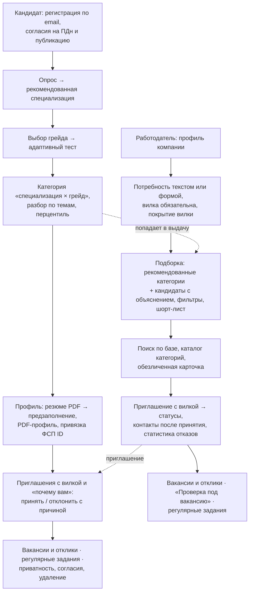
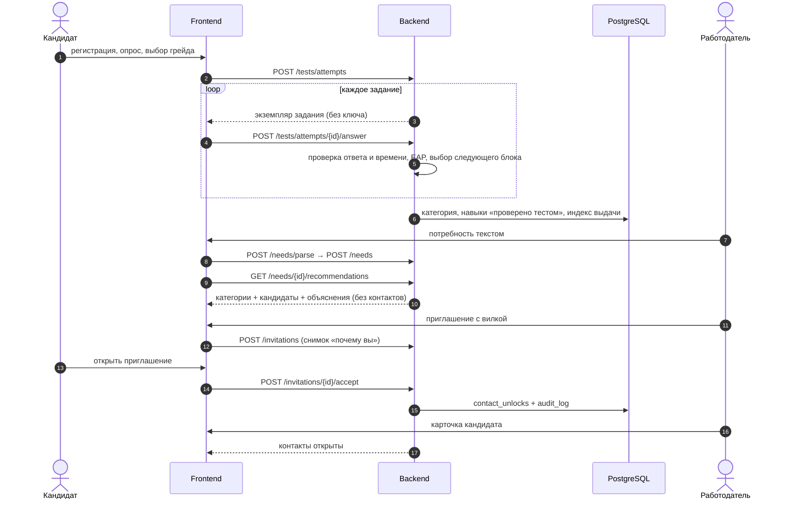
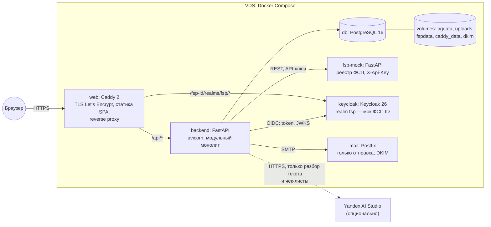
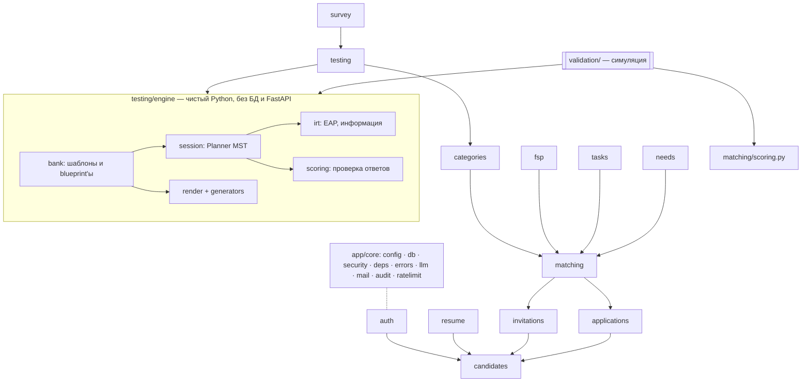
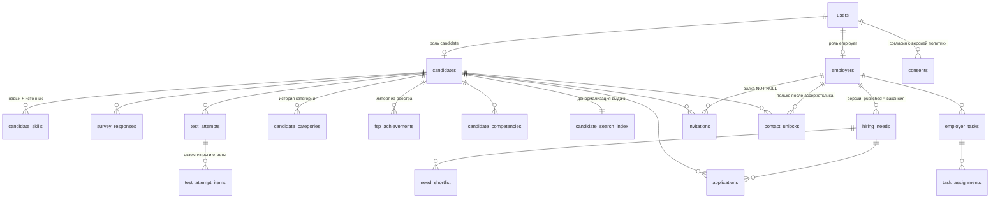
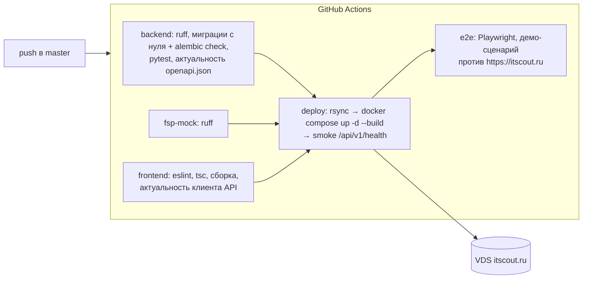

# Архитектура

ITScout — модульный монолит на FastAPI с отдельным сервисом-моком реестра ФСП и SPA на React. Слои разделены по требованиям п. 3.5 ТЗ: веб-приложение для обеих ролей (frontend), API бизнес-логики (backend) и реляционное хранилище (PostgreSQL 16). Всё упаковано в Docker и поднимается одним `docker compose`.

## 1. Функциональная архитектура

### 1.1. Роли и сценарии

| Функциональный блок | Что делает | Модуль backend | Экраны frontend |
|---|---|---|---|
| Регистрация и сессии | email и пароль, согласия, подтверждение почты, JWT + refresh, демо-вход | `auth` | вход, регистрация, подтверждение |
| Справочники | специализации, грейды, 164 навыка с алиасами, отрасли, роли, софт-скиллы, компетенции ФСП | `catalog` | формы и фильтры |
| Онбординг | опрос из 12 вопросов → баллы специализаций, выбор грейда | `survey` | мастер онбординга |
| Тестирование | сборка теста по blueprint, MST, рендер экземпляров, EAP, решение о грейде, разбор по темам | `testing` (+ `testing/engine`) | тест, результат |
| Категории и грейд | правила смены грейда, интервалы, перцентили, история | `categories` | «Категория и грейд» |
| Профиль кандидата | анкета, опыт, навыки с источниками, приватность, согласия, удаление | `candidates` | профиль, настройки |
| Резюме и PDF | pdfplumber → словарь/LLM → предзаполнение; PDF-профиль WeasyPrint | `resume` | профиль |
| ФСП | ручная привязка и OIDC через ФСП ID, импорт, сила результатов, компетенции | `fsp` | настройки, карточка кандидата |
| Работодатель | профиль компании, статистика отказов | `employers` | компания, дашборд |
| Потребности и вакансии | разбор текста, версии, публикация | `needs` | потребности, вакансии |
| Подбор | индекс выдачи, фильтры, score, объяснения, рекомендации категорий, покрытие вилки | `matching` | подборка, поиск, каталог, карточка |
| Приглашения | статусы, лимит, срок, раскрытие контактов, аудит | `invitations` | приглашения у обеих сторон |
| Отклики | отклик раскрывает контакты, сортировка по score | `applications` | вакансии и отклики |
| Регулярные задания | автопроверка шаблоном или оценка подхода | `tasks` | задания у обеих сторон |
| Служебное | `/health`, сброс демо-данных, сброс ограничений в демо | `admin` | — |

### 1.2. Сквозной сценарий

## 2. Компонентная архитектура

| Компонент | Технологии | Ответственность | Память на проде |
|---|---|---|---|
| `web` | Caddy 2 + собранный Vite-бандл | HTTPS, SPA с fallback на `index.html`, прокси `/api/*` в backend и `/fsp-id/*` в Keycloak (наружу только realm `fsp`, админка закрыта) | ~30 МБ |
| `backend` | Python 3.12, FastAPI, SQLAlchemy 2 async, psycopg 3, numpy/scipy, WeasyPrint | вся бизнес-логика и API `/api/v1`, миграции Alembic при старте | ~250 МБ |
| `db` | PostgreSQL 16 | 26 таблиц, CHECK-ограничения на вилку и статусы | ~150 МБ |
| `fsp-mock` | FastAPI | внешняя система «реестр ФСП»: участники, результаты, разряды; данные пишет генератор демо-данных | ~80 МБ |
| `keycloak` | Keycloak 26.4 | мок IdP «ФСП ID»: authorization code + PKCE, claim `fsp_id` | ~500 МБ (лимит 1 ГБ) |
| `mail` | Postfix (`boky/postfix`) | отправка писем подтверждения от `noreply@itscout.ru` с DKIM | — |
| Yandex AI Studio | внешний LLM, выключатель `LLM_PROVIDER` | разбор текста резюме и потребностей, чек-лист открытых ответов, черновики шаблонов | — |

Весь стенд занимает около 1,1 ГБ RAM и работает на недорогом VDS (прод — 7,25 ГБ RAM и своп 2 ГБ; до апгрейда работал и на 3,3 ГБ) — в пределах требования п. 3.1 ТЗ.

### 2.1. Backend: модули

- Каждый модуль — `router.py` (тонкий: валидация, зависимости, вызов сервиса), `service.py` (бизнес-логика), `models.py`, `schemas.py`. Модули обращаются к чужим `service`, а не к чужим моделям.
- `testing/engine` и `matching/scoring.py` — чистые функции без БД и HTTP. Их же вызывает `validation/`, поэтому валидация проверяет ровно тот код, что работает в продукте.
- Справочники, blueprint'ы, веса и пороги — YAML в `backend/content/`, загружаются при старте. Числа в коде не зашиваются.
- Ошибки — доменные исключения `AppError` → единый ответ `{error: {code, message, details}}`.

### 2.2. Frontend

React 19 + Vite + TypeScript (strict). Маршруты — React Router, серверное состояние — TanStack Query, формы — react-hook-form + zod, UI — Tailwind 4 и компоненты в стиле shadcn/ui, графики — Recharts. Типы и клиент API генерируются из `backend/openapi.json` (`openapi-typescript` + `openapi-fetch`) — руками не описываются. Тема сделана по брендбуку ФСП: `#402FFF` основной, `#EC1D35` точечный акцент, JetBrains Mono для заголовков и цифр, Inter для текста.

| Папка | Содержимое |
|---|---|
| `src/app` | роутер, провайдеры, guard'ы по ролям |
| `src/layouts` | публичный макет и кабинеты кандидата и работодателя |
| `src/pages/public`, `candidate`, `employer` | экраны (у каждого есть состояния загрузки, пустого списка и ошибки) |
| `src/components` | общие компоненты: бейджи категории и score, вилка, объяснение, статусы |
| `src/api` | сгенерированная схема и клиент |

## 3. Модель данных

26 таблиц. Ниже — основные связи (служебные таблицы токенов, аудита и статистики шаблонов опущены).

Ключевые ограничения в БД:
- `salary_from`, `salary_to` в `hiring_needs` и `invitations` — `NOT NULL`, оба больше 0, `salary_from ≤ salary_to` (CHECK);
- статусы и роли — VARCHAR с одним CHECK на колонку;
- ключи ответов (`answer_key`) хранятся только в `test_attempt_items` и `task_assignments` и не попадают ни в одну схему ответа API;
- `candidate_search_index` пересчитывается синхронно при изменении профиля, категории, ФСП или заданий.

Полный список полей — `docs/implementation.md` §14, схема в коде — `backend/app/modules/*/models.py`, миграции — `backend/migrations/`.

## 4. Развёртывание и CI/CD

Пошаговые инструкции — [deploy.md](deploy.md).

## 5. Масштабирование и интеграции

- **Горизонтально.** Backend не хранит состояние в процессе, кроме лимитера частоты запросов `/auth/*` (in-memory) — при нескольких репликах он переносится в Redis или Postgres. Файлы резюме лежат в volume `uploads` — при масштабировании переносятся в S3-совместимое хранилище.
- **Выдача.** Подбор читает денормализованный `candidate_search_index` и считает score в памяти для кандидатов подходящих категорий: на текущем объёме (600+ кандидатов) это миллисекунды. При росте базы — предфильтр по видимости, скрытым компаниям и специализациям делается в SQL, следующий шаг — материализованные score по активным потребностям.
- **Внешние системы.** Реестр ФСП подключён через HTTP-клиент с API-ключом и заменяется настоящим без правок кода, ФСП ID — через стандартный OIDC (см. [fsp-integration.md](fsp-integration.md)). ATS подключается по API-ключу работодателя и получает подписанные webhook'и из outbox-таблицы с повторами (см. [anti-fraud-ats.md](anti-fraud-ats.md)).
