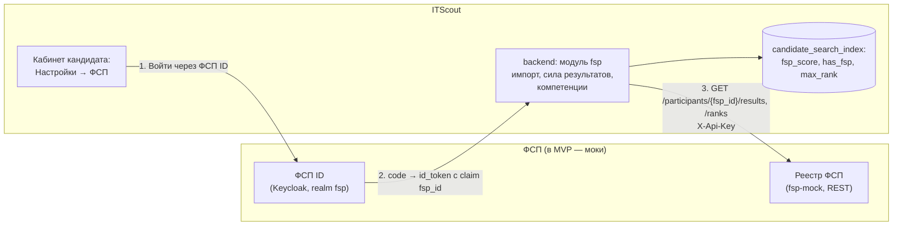
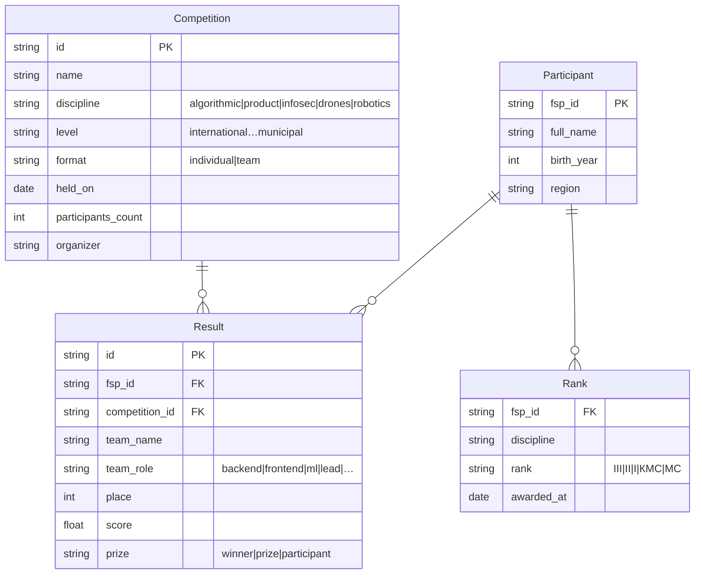

# Интеграция с реестром ФСП

Доступ к API и данным реестра ФСП в рамках хакатона не предоставляется (п. 4 ТЗ), поэтому мы предлагаем модель данных, реализуем её в отдельном сервисе-моке и строим интеграцию так, чтобы в проде мок заменялся настоящим реестром и ФСП ID без правок кода backend.

## 1. Схема интеграции



| Граница | MVP | Прод ФСП |
|---|---|---|
| Идентификация участника | Keycloak 26, realm `fsp`, клиент `itscout` (публичный, authorization code + PKCE S256), mapper атрибута `fsp_id` в claim | реальный ФСП ID на Keycloak: меняются только настройки `FSP_OIDC_DISCOVERY_URL`, `FSP_OIDC_CLIENT_ID`, при необходимости `FSP_OIDC_CLIENT_SECRET` |
| Данные о достижениях | `fsp-mock`: REST `/fsp-api/v1`, ключ в заголовке `X-Api-Key` | REST API реестра с OAuth2 client credentials, `FSP_API_URL` и ключ из `.env` |
| Согласие | отметка «согласен на импорт» → запись `fsp_import` в `consents` | то же + scope согласия `fsp:achievements:read` в токене |
| Обновление | импорт при привязке | webhook реестра о новых результатах или ежедневный повторный импорт |

## 2. Модель данных реестра (наше предложение)



API мока (`fsp-mock/app/main.py`, Swagger — `/fsp-api/docs` внутри сети compose, в dev — http://localhost:8001/fsp-api/docs):

| Метод | Путь | Ответ |
|---|---|---|
| `GET` | `/fsp-api/v1/participants/{fsp_id}` | участник |
| `GET` | `/fsp-api/v1/participants/{fsp_id}/results` | результаты с данными соревнований |
| `GET` | `/fsp-api/v1/participants/{fsp_id}/ranks` | разряды |
| `GET` | `/fsp-api/v1/competitions` | соревнования |
| `GET` | `/health` | живость |

Данные мока (40 соревнований с уровнями, датами и числом участников, результаты демо-кандидатов) пишет генератор демо-данных в общий volume. Список дисциплин и ролей нужно сверить с экспертами ФСП — он вынесен в `backend/content/discipline_map.yaml` и меняется без правок кода.

## 3. Привязка ФСП ID

| Способ | Как работает | Что получает кандидат |
|---|---|---|
| Ручной | кандидат вводит ФСП ID и даёт согласие на импорт; backend забирает данные из реестра | достижения с пометкой «владение не подтверждено» |
| OIDC через ФСП ID | «Войти через ФСП ID» → вход в IdP → `fsp_id` из подписанного `id_token` | достижения с подтверждённым владением; ручная привязка того же ID повышается до подтверждённой |

```mermaid
sequenceDiagram
  autonumber
  actor К as Кандидат
  participant F as Frontend
  participant B as Backend
  participant K as ФСП ID (Keycloak)
  participant R as Реестр ФСП
  К->>F: согласие на импорт + «Войти через ФСП ID»
  F->>B: GET /fsp/oidc/start?consent=true
  B-->>F: authorization_url + httpOnly cookie (state, PKCE verifier, nonce, id кандидата; подпись, 10 минут)
  F->>K: редирект на страницу входа
  К->>K: логин и пароль участника
  K->>B: GET /fsp/oidc/callback?code&state
  B->>B: state сверяется с cookie
  B->>K: обмен code + code_verifier на токены
  B->>B: id_token: подпись по JWKS, iss, aud, exp, nonce → claim fsp_id
  B->>R: результаты и разряды по fsp_id
  B->>B: согласие fsp_import, аудит, сила результатов, компетенции, пересчёт индекса выдачи
  B-->>F: редирект в настройки ?fsp_oidc=linked
```

Защита флоу: verifier не попадает в URL, callback привязан к браузеру и кандидату подписанной cookie, повторный callback не проходит (cookie удаляется), принимаются только асимметричные алгоритмы подписи, ФСП ID, уже привязанный к другому кандидату, отклоняется (`fsp_id_taken`). Отзыв согласия на импорт удаляет импортированные данные.

## 4. Из результатов — в компетенции и подбор

Сырые результаты превращаются в силу результата и компетенции (`backend/app/modules/fsp/evidence.py`, константы — `backend/content/rules.yaml`):

```text
percentile  = 1 − (place − 1) / max(participants − 1, 1)
strength    = percentile × level_weight × 0,5^(возраст_в_годах / 3)
competency  = 1 − Π(1 − strength_i)          # noisy-OR по результатам; для связи по роли strength × 0,7
competency  = max(competency, rank_floor)     # МС 0,95 · КМС 0,85 · I 0,70 · II 0,55 · III 0,40
fsp_score   = max over competencies ( competency × relevance(специализация, компетенция) )
```

| Уровень соревнования | level_weight |
|---|---|
| международное | 1,0 |
| всероссийское | 0,9 |
| межрегиональное | 0,75 |
| региональное | 0,6 |
| муниципальное | 0,4 |

| Дисциплина ФСП | Компетенции |
|---|---|
| Алгоритмическое программирование | алгоритмы и структуры данных |
| Продуктовое программирование | командная продуктовая разработка; по роли в команде — backend, frontend, ML-разработка, лидерство |
| Информационная безопасность | ИБ (CTF) |
| Беспилотные авиационные системы, робототехника | программирование БАС и робототехники (общий инженерный сигнал) |

Связь компетенций со специализациями (`backend/content/competency_relevance.yaml`): например, для Backend — backend-разработка 1,0, алгоритмы 0,8, продуктовая разработка 0,7, CTF 0,6; для DevOps — CTF 1,0.

`fsp_score` входит в score подбора с весом 0,10 и в силу профиля внутри категории с весом 0,15. Технологический навык (Python, Docker) из данных ФСП получает максимум статус «подтверждено ФСП» и только через роль в продуктовой дисциплине: **проверенным навык делает только тест**.

## 5. Показ работодателю и кандидату

- В списке кандидатов — бейдж «ФСП» и разряд; фильтры «есть ФСП», дисциплина, минимальный разряд.
- В карточке — блок «Подтверждено ФСП»: разряд, сильнейшие результаты (место, число участников, уровень, год, роль), компетенции со статусом.
- В объяснении выдачи — строка с лучшим результатом: «ФСП: 2 место, всероссийский хакатон по продуктовому программированию (роль backend), 2025».
- **Без истории ФСП** — нейтральная плашка «Данных ФСП нет», без штрафа: категория и score по остальным компонентам считаются полностью. Кандидату предлагается привязать ФСП ID или поучаствовать в соревнованиях ФСП — это ещё и воронка в соревнования.

## 6. Демо-участники мок-IdP

Логины и общий тестовый пароль — в `infra/keycloak/fsp-realm.json` (это демо-учётки мока, не реальные данные).

| Логин | ФСП ID | Сценарий |
|---|---|---|
| `fsp-2026-7781` | FSP-2026-7781 | участник реестра без профиля на платформе — живая привязка новым кандидатом |
| `anna.kovaleva` | FSP-2026-1001 | демо-кандидат Анна: ручная привязка повышается до подтверждённой |
| `maria.orlova` | FSP-2026-1002 | попытка привязать чужой ФСП ID → отказ `fsp_id_taken` |
