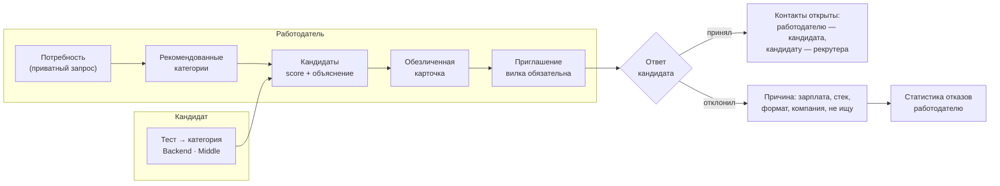

# Механика подбора и категоризация

## 1. Обратная механика

На классических площадках кандидат рассылает резюме, а работодатель фильтрует поток самоописаний. В ITScout наоборот: **кандидат один раз подтверждает уровень тестом, а работодатель сам находит его в пуле и приходит с предложением**, в котором уже указана вилка зарплаты.



Классический путь тоже есть: потребность можно опубликовать как вакансию, кандидат откликается, и отклик сразу открывает работодателю его контакты (п. 2.2 ТЗ).

## 2. Категоризация кандидатов

Категория — пара **«специализация × грейд»**, например «Backend · Middle». Она назначается только по итогам опроса и теста:

| Шаг | Что определяет | Как |
|---|---|---|
| Опрос (12 вопросов, `content/survey.yaml`) | специализацию и стек | у каждого ответа веса специализаций; сумма → топ-2 рекомендованных, кандидат подтверждает выбор. Языки и фреймворки задают стек-модули теста |
| Выбор грейда | с какого теста начать | подсказка по стажу; выбирает сам кандидат |
| Тест | грейд | θ̂ на шкале специализации против порогов грейдов ([testing.md](testing.md)) |
| Результат | категорию, перцентиль, проверенные навыки | категория «специализация × грейд», перцентиль θ̂ внутри категории, навыки «проверено тестом» |

**Резюме и LLM категорию не задают.** Резюме только предзаполняет профиль: навыки из него получают статус «заявлено». Подтвердить навык может тест (≥ 2 задания по навыку и ≥ 70% верно), ФСП (через роль в продуктовой дисциплине) или регулярное задание.

**Статусы навыка** и их ценность при подборе (`content/matching.yaml`):

| Статус | Источник | Ценность v |
|---|---|---|
| Проверено тестом | тест | 1,0 |
| Подтверждено ФСП | результат ФСП с ролью | 0,9 |
| Подтверждено заданием | регулярное задание с автопроверкой | 0,9 |
| Заявлено | анкета или резюме | 0,5 |
| Только родительский навык | есть Python, требуется FastAPI | 0,3 |

**Кто виден в поиске:** есть согласие на публикацию профиля, статус поиска не «не ищу», есть действующая категория, компания не в списке скрытых у кандидата.

Точность категоризации по данным симуляции: специализация по опросу верна у 97,2% (в топ-2 — 99,7%), грейд по тесту совпадает с истинным у 81,2% без ошибок больше чем на один грейд ([validation.md](validation.md)).

## 3. Потребность работодателя

Потребность — приватный запрос на подбор, не публичная вакансия. Её можно задать формой или текстом: словарный разбор (`needs/parser.py`) распознаёт специализацию, грейд, обязательный и желательный стек по 164 навыкам с алиасами, отрасль, формат, город и вилку; LLM, если включён, только дополняет пустые поля значениями из справочников. Нераспознанные термины показываются: «не распознали: X, Y». **Вилка «от–до» в рублях обязательна** — это проверяется схемой API и CHECK-ограничением в БД. Правка потребности создаёт новую версию, предыдущая остаётся в истории.

## 4. Подборка

Экран подборки двухуровневый.

**Рекомендованные категории** — точная категория потребности и соседние (грейд ±1, смежная специализация) со счётчиками и объяснением: «Backend · Middle — точное совпадение, 37 кандидатов, 12 с ФСП, ваша вилка покрывает ожидания 64%».

**Кандидаты** — по умолчанию сгруппированы по категориям (сначала точная, затем соседний грейд и смежные специализации; внутри группы — по score), переключатель «общий топ» сортирует всех по score. Строка кандидата: score, категория, 2–3 причины, бейджи (ФСП, «проверено тестом», свежесть).

### 4.1. Жёсткие фильтры

Кандидаты, не прошедшие фильтр, не исчезают, а уходят в свёрнутый блок «Вне фильтров» с причиной:
- несовместимый формат работы;
- другой город без готовности к переезду, если работа не удалённая;
- минимальные ожидания выше верхней границы вилки больше чем на 30%.

### 4.2. Score

```text
match = 100 × (0,30·skills + 0,30·strength + 0,15·category + 0,10·fsp + 0,05·fresh + 0,10·conditions)
```

| Компонент | Расчёт |
|---|---|
| `category` | 1,0 — та же специализация и грейд; 0,6 — смежная специализация или грейд ±1; 0,3 — и то и другое; иначе кандидат в выдачу не попадает |
| `skills` | Σ(w·v) / Σw по стеку потребности: w = 1,0 для обязательных навыков и 0,3 для желательных, v — ценность статуса навыка (таблица выше), 0 — навыка нет |
| `strength` | 0,7·Φ((θ̂ − cut_грейда_потребности) / 0,6) + 0,3·topic_fit. θ̂ лежит на общей шкале специализации, поэтому кандидаты разных грейдов сравнимы. `topic_fit` — средний балл по темам теста, которые проверяют навыки потребности (нужен PostgreSQL → тема «Базы данных») |
| `fsp` | max по компетенциям ФСП: competency_score × relevance(специализация, компетенция) ([fsp-integration.md](fsp-integration.md)); 0, если ФСП нет |
| `fresh` | 0,5^(дней с последнего проверенного действия / 90) — тест или решённое задание |
| `conditions` | 0,6·salary_fit + 0,4·format_fit; salary_fit = 1, если минимальные ожидания ≤ верхней границы вилки, и линейно падает до 0 при превышении на 30% |

Веса и пороги — `backend/content/matching.yaml`, функции — `backend/app/modules/matching/scoring.py` (чистые, их же вызывает валидация).

**Без потребности** (каталог категорий, поиск по базе) кандидаты внутри категории упорядочены по силе подтверждённого профиля:

```text
VPS = 0,60·перцентиль θ̂ в категории + 0,15·fsp + 0,15·fresh + 0,10·approach
```

`approach` — оценка решений на подход (регулярные задания). При равенстве score выше кандидат с более сильным ФСП, затем более свежий.

### 4.3. Объяснимость

Объяснение собирается **кодом из тех же компонентов, что и score** (`scoring.explain`), поэтому всегда с ним совпадает. LLM в объяснении не участвует.

```text
Анна К. · Backend · Middle · 84
✓ Категория совпадает: Backend · Middle, подтверждено тестом (78-й перцентиль)
✓ PostgreSQL — проверено тестом: «Базы данных» 85%
✓ Python — проверено тестом, FastAPI — заявлено
✓ ФСП: 2 место, всероссийский хакатон по продуктовому программированию (роль backend), 2025
⚠ Kafka — нет данных
⚠ Ожидания от 280 000 ₽ — выше вилки (до 250 000 ₽)
```

Порядок строк: категория, затем предупреждения (их важно увидеть сразу), затем плюсы. Тот же текст прикладывается к приглашению снимком, и **кандидат видит «почему вам»** так же, как работодатель.

### 4.4. Уточнение без потери подборки

Фильтры (есть ФСП, только проверенный стек, грейд, формат, зарплата и др.) применяются поверх результата, их состояние хранится в URL. Кнопка «В шорт-лист» закрепляет кандидата за потребностью: он остаётся в шорт-листе при любой смене фильтров и правке потребности.

## 5. Приглашение и раскрытие контактов

- Приглашение: заголовок, описание предложения, **вилка (обязательно)**, компания, способ связи (рекрутер, Telegram, email, телефон), необязательная привязка к потребности, срок ответа (14 дней) и снимок объяснения.
- Статусы: `sent → viewed → accepted | declined | expired | withdrawn`; обе стороны видят актуальный статус.
- Контакты кандидата не отдаются работодателю ни одним эндпоинтом (включая PDF-профиль), пока нет записи в `contact_unlocks` — она появляется при принятии приглашения или отклике и пишется в аудит. Раскрытие симметричное: контакт рекрутера кандидат видит тоже только после принятия.
- Пригласить можно только кандидата, который виден компании в поиске; у компании не больше одного активного приглашения одному кандидату.

## 6. Чем механика выделяется

| Фишка | Что даёт |
|---|---|
| Покрытие вилки | при вводе вилки работодатель сразу видит, какой доле кандидатов категории она подходит; в списке — пометка «ожидания выше вилки» |
| Статистика отказов | работодатель видит агрегат причин: «3 из 5 отказов — зарплата» |
| Лимит активных приглашений | не больше 15 на потребность по всей цепочке версий — приглашать адресно, а не рассылать спам |
| «Почему вам» | прозрачность объяснения в обе стороны |
| Слепой первый просмотр | без фото, возраста и пола, фамилия скрыта до контакта — меньше предвзятости |
| Регулярные задания | короткое задание от работодателя раз в неделю: освежает профиль, подтверждает навыки и даёт повод для первого контакта |

## 7. Проверка качества подбора

По симуляции (15 потребностей, 2 000 кандидатов, истинная релевантность 0–3 из истинных специализации, грейда и стека):

| Способ ранжирования | P@5 | nDCG@10 |
|---|---|---|
| ITScout: выдача по категориям (по умолчанию) | 0,68 | 0,77 |
| ITScout: «общий топ» по score | 0,49 | 0,67 |
| категория по тесту + ключевые слова | 0,80 | 0,88 |
| заявленный грейд + ключевые слова | 0,71 | 0,80 |
| только ключевые слова резюме | 0,29 | 0,45 |

Категория по тесту как фильтр точнее самоописания, а выдача ITScout в 2,3 раза точнее поиска по ключевым словам резюме. Почему «общий топ» уступает группировке и почему выдача ниже варианта «категория + ключевые слова» — в [validation.md](validation.md), раздел «Подбор».
