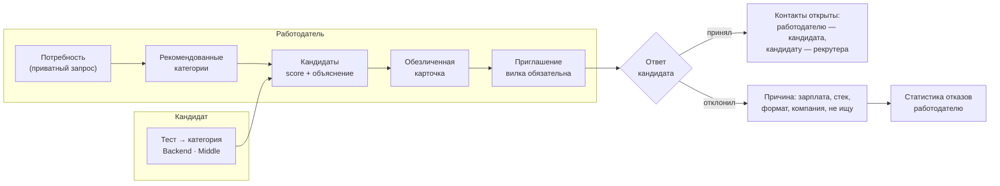

# Механика подбора и категоризация

## 1. Обратная механика

На классических площадках кандидат рассылает резюме, а работодатель фильтрует поток самоописаний. В ITScout наоборот: **кандидат один раз подтверждает уровень тестом, а работодатель сам находит его в пуле и приходит с предложением**, в котором уже указана вилка зарплаты.



Классический путь тоже есть: потребность можно опубликовать как вакансию, кандидат откликается, и отклик сразу открывает работодателю его контакты (п. 2.2 ТЗ).

## 2. Категоризация кандидатов

Категория — пара **«специализация × грейд»**, например «Backend · Middle». Она назначается только по итогам опроса и теста:

| Шаг | Что определяет | Как |
|---|---|---|
| Опрос (12 вопросов, `content/survey.yaml`) | специализацию и стек | у каждого ответа веса специализаций; сумма → топ-2 рекомендованных, кандидат подтверждает выбор. Языки и фреймворки задают стек-модули теста |
| Выбор грейда | с какого теста начать | подсказка по стажу; выбирает сам кандидат |
| Тест | грейд | θ̂ на шкале специализации против порогов грейдов ([testing.md](testing.md)) |
| Результат | категорию, перцентиль, проверенные навыки | категория «специализация × грейд», перцентиль θ̂ внутри категории, навыки «проверено тестом» |

**Резюме и LLM категорию не задают.** Резюме только предзаполняет профиль: навыки из него получают статус «заявлено». Подтвердить навык может тест (≥ 2 задания по навыку и ≥ 70% верно), ФСП (через роль в продуктовой дисциплине) или регулярное задание.

**Статусы навыка** и их ценность при подборе (`content/matching.yaml`):

| Статус | Источник | Ценность v |
|---|---|---|
| Проверено тестом | тест | 1,0 |
| Подтверждено ФСП | результат ФСП с ролью | 0,9 |
| Подтверждено заданием | регулярное задание с автопроверкой | 0,9 |
| Заявлено | анкета или резюме | 0,5 |
| Только родительский навык | есть Python, требуется FastAPI | 0,3 |
| Близкий навык | есть MySQL, требуется PostgreSQL | близость × ценность статуса близкого, не больше 0,3 |

**Близость навыков** — замороженная таблица `backend/content/skill_similarity.yaml`: 83 пары навыков из справочника, составленные вручную по иерархии ESCO и семействам навыков (PostgreSQL ↔ MySQL 0,7, Kafka ↔ RabbitMQ 0,5, React ↔ Vue 0,5, GitLab CI ↔ GitHub Actions 0,7 …). В рантайме ничего не вычисляется и LLM не участвует. Пример: проверенный тестом MySQL за требуемый PostgreSQL — min(0,3; 0,7 × 1,0) = 0,3, заявленный RabbitMQ за Kafka — 0,5 × 0,5 = 0,25. Потолок 0,3 — как у родительского навыка: синтетическая истина считает близкий навык отсутствием, и с потолком 0,6 P@5 бенчмарка падал на 0,05, а с 0,3 — на 0,01 (в пределах шума). Выключатель и потолок — `skill_similarity` в `content/matching.yaml`. Фильтры по навыкам в поиске и подборке остаются точными.

**Кто виден в поиске:** есть согласие на публикацию профиля, статус поиска не «не ищу», есть действующая категория, компания не в списке скрытых у кандидата.

Точность категоризации по данным симуляции: специализация по опросу верна у 97,2% (в топ-2 — 99,7%), грейд по тесту совпадает с истинным у 81,6% без ошибок больше чем на один грейд ([validation.md](validation.md)).

## 3. Потребность работодателя

Потребность — приватный запрос на подбор, не публичная вакансия. Её можно задать формой или текстом: словарный разбор (`needs/parser.py`) распознаёт специализацию, грейд, обязательный и желательный стек по 164 навыкам с алиасами, отрасль, формат, город и вилку; LLM, если включён, только дополняет пустые поля значениями из справочников. Нераспознанные термины показываются: «не распознали: X, Y». **Вилка «от–до» в рублях обязательна** — это проверяется схемой API и CHECK-ограничением в БД. Правка потребности создаёт новую версию, предыдущая остаётся в истории.

## 4. Подборка

Экран подборки двухуровневый.

**Рекомендованные категории** — точная категория потребности и соседние (грейд ±1, смежная специализация) со счётчиками и объяснением: «Backend · Middle — точное совпадение, 37 кандидатов, 12 с ФСП, ваша вилка покрывает ожидания 64%».

**Кандидаты** — по умолчанию сгруппированы по категориям (сначала точная, затем соседний грейд и смежные специализации; внутри группы — по score), переключатель «общий топ» сортирует всех по score. Строка кандидата: score, категория, 2–3 причины, бейджи (ФСП, «проверено тестом», свежесть).

### 4.1. Жёсткие фильтры

Кандидаты, не прошедшие фильтр, не исчезают, а уходят в свёрнутый блок «Вне фильтров» с причиной:
- несовместимый формат работы;
- другой город без готовности к переезду, если работа не удалённая;
- минимальные ожидания выше верхней границы вилки больше чем на 30%.

### 4.2. Score

```text
match = 100 × (0,45·skills + 0,22·strength + 0,16·category + 0,01·fsp + 0,05·fresh + 0,11·conditions)
```

| Компонент | Расчёт |
|---|---|
| `category` | 1,0 — та же специализация и грейд; 0,6 — смежная специализация; 0,3 — грейд ±1; 0,15 — и то и другое; иначе кандидат в выдачу не попадает |
| `skills` | Σ(w·v) / Σw по стеку потребности: w = 1,0 для обязательных навыков и 0,3 для желательных, v — ценность статуса навыка (таблица выше, включая близкий навык), 0 — навыка нет |
| `strength` | 0,7·ability + 0,3·topic_fit, где ability = Φ((θ̂ − cut_грейда) / 0,6) − 1,5·max(0, 2·Φ((θ̂ − cut_следующего) / 0,6) − 1). До порога следующего грейда более сильный по тесту выше; кандидат, по тесту уже переросший нужный грейд, получает штраф и предупреждение в объяснении. θ̂ лежит на общей шкале специализации, поэтому кандидаты разных грейдов сравнимы. `topic_fit` — средний балл по темам теста, которые проверяют навыки потребности (нужен PostgreSQL → тема «Базы данных») |
| `fsp` | max по компетенциям ФСП: competency_score × relevance(специализация, компетенция) ([fsp-integration.md](fsp-integration.md)); 0, если ФСП нет |
| `fresh` | 0,5^(дней с последнего проверенного действия / 90) — тест или решённое задание |
| `conditions` | 0,6·salary_fit + 0,4·format_fit; salary_fit = 1, если минимальные ожидания ≤ верхней границы вилки, и линейно падает до 0 при превышении на 30% |

Веса и пороги — `backend/content/matching.yaml`, функции — `backend/app/modules/matching/scoring.py` (чистые, их же вызывает валидация).

**Без потребности** (каталог категорий, поиск по базе) кандидаты внутри категории упорядочены по силе подтверждённого профиля:

```text
VPS = 0,60·перцентиль θ̂ в категории + 0,15·fsp + 0,15·fresh + 0,10·approach
```

`approach` — оценка решений на подход (регулярные задания). При равенстве score выше кандидат с более сильным ФСП, затем более свежий.

### 4.3. Объяснимость

Объяснение собирается **кодом из тех же компонентов, что и score** (`scoring.explain`), поэтому всегда с ним совпадает. LLM в объяснении не участвует.

```text
Анна К. · Backend · Middle · 84
✓ Категория совпадает: Backend · Middle, подтверждено тестом (78-й перцентиль)
✓ PostgreSQL — проверено тестом: «Базы данных» 85%
✓ Python — проверено тестом, FastAPI — заявлено
✓ ФСП: 2 место, всероссийский хакатон по продуктовому программированию (роль backend), 2025
⚠ Kafka — нет данных
⚠ Ожидания от 280 000 ₽ — выше вилки (до 250 000 ₽)
```

Порядок строк: категория, затем предупреждения (их важно увидеть сразу), затем плюсы. Зачёт близкого навыка — отдельной строкой: «PostgreSQL — нет, есть близкий MySQL (зачтено 30%)». Тот же текст прикладывается к приглашению снимком, и **кандидат видит «почему вам»** так же, как работодатель.

### 4.5. Вероятность, что кандидат примет приглашение

Работодателю важно не только «подходит ли кандидат», но и «откликнется ли он» — так устроены двусторонние рекомендации (LinkedIn Recruiter оптимизирует принятые InMail). Данных о принятиях для обучения пока нет, поэтому оценка — прозрачная логистическая модель с коэффициентами в `content/matching.yaml` (`acceptance`), без ML и LLM:

```text
p = σ(0,2 + 4·(верх вилки − ожидания)/ожидания [+0,4, если вся вилка не ниже ожиданий]
        ± формат (+0,3 / −1,5) − город (−0,6 с переездом, −2,0 без)
        + 0,5 «активно ищу» − 0,15 за каждое чужое активное приглашение
        − 1,0·доля отказов «не ищу»)
```

Если у кандидата не меньше двух отказов, их причины усиливают соответствующий фактор: доля отказов «зарплата» — эффект вилки, «формат» — формат и город. Работодатель видит строку под объяснением в подборке и в карточке кандидата: «Вероятность, что кандидат примет приглашение: высокая — вилка покрывает ожидания, формат работы совпадает». Текст собран из тех же вкладов, что и число. Кандидату эта строка не показывается.

По умолчанию оценка **только показывается** и порядок выдачи не меняет (`acceptance.rank_weight: 0`): вилка и формат уже входят в score компонентом `conditions`, а коэффициенты не откалиброваны на реальных ответах. На синтетике множитель поднимает долю принявших в топ-5 (раздел 7), но эта оценка — сверху: синтетическая «истина» построена из тех же по природе факторов. Флаг `rank_weight` > 0 включает множитель match × ((1 − w) + w·p) в том же `scoring.evaluate`, `enabled: false` убирает оценку совсем.

### 4.4. Уточнение без потери подборки

Фильтры (есть ФСП, только проверенный стек, грейд, формат, зарплата и др.) применяются поверх результата, их состояние хранится в URL. Кнопка «В шорт-лист» закрепляет кандидата за потребностью: он остаётся в шорт-листе при любой смене фильтров и правке потребности.

## 5. Приглашение и раскрытие контактов

- Приглашение: заголовок, описание предложения, **вилка (обязательно)**, компания, способ связи (рекрутер, Telegram, email, телефон), необязательная привязка к потребности, срок ответа (14 дней) и снимок объяснения.
- Статусы: `sent → viewed → accepted | declined | expired | withdrawn`; обе стороны видят актуальный статус.
- Контакты кандидата не отдаются работодателю ни одним эндпоинтом (включая PDF-профиль), пока нет записи в `contact_unlocks` — она появляется при принятии приглашения или отклике и пишется в аудит. Раскрытие симметричное: контакт рекрутера кандидат видит тоже только после принятия.
- Пригласить можно только кандидата, который виден компании в поиске; у компании не больше одного активного приглашения одному кандидату.

### 5.1. Рынок категории для кандидата

Кандидат в кабинете видит «Рынок вашей категории» (`GET /candidates/me/market`): сколько действующих потребностей и вакансий в его категории и рядом, медианную вилку против своих ожиданий, топ навыков с долей потребностей и своим статусом (проверено / заявлено / нет). Блок «что поможет» — контрфактический пересчёт тем же skills-компонентом, что и score подбора: «Подтвердите Kafka тестом или заданием — подходящих потребностей станет больше на 4». Всё детерминированно, без LLM. Наружу — только агрегаты, без названий компаний; вилки и навыки скрываются, если потребностей меньше 3 или компаний меньше 2 (`insights` в `content/matching.yaml`). Неопубликованные потребности — внутренние планы компаний; они входят в агрегаты по настройке `insights.include_unpublished` (по умолчанию да, `false` — только открытые вакансии).

## 6. Чем механика выделяется

| Фишка | Что даёт |
|---|---|
| Покрытие вилки | при вводе вилки работодатель сразу видит, какой доле кандидатов категории она подходит; в списке — пометка «ожидания выше вилки» |
| Статистика отказов | работодатель видит агрегат причин: «3 из 5 отказов — зарплата» |
| Лимит активных приглашений | не больше 15 на потребность по всей цепочке версий — приглашать адресно, а не рассылать спам |
| «Почему вам» | прозрачность объяснения в обе стороны |
| Вероятность принятия | работодатель видит, примет ли кандидат приглашение и почему: вилка против ожиданий, формат, город, статус поиска, прошлые отказы |
| Близкие навыки | MySQL вместо PostgreSQL засчитывается частично и с пояснением, а не как «нет навыка» |
| Вилка против рынка | работодатель сразу видит, что вилка ниже рынка или подозрительно высокая; кандидат видит ту же пометку в приглашении |
| Рынок категории для кандидата | счётчики потребностей, медианная вилка, топ навыков и «что поможет» с эффектом в числе потребностей — только агрегаты |
| Слепой первый просмотр | без фото, возраста и пола, фамилия скрыта до контакта — защита приватности кандидата; оценку дают тест и навыки. Устранить предвзятость одним обезличиванием мы не обещаем: эксперимент австралийской госслужбы показал обратный эффект (см. `docs/research/matching.md`) |
| Регулярные задания | короткое задание от работодателя раз в неделю: освежает профиль, подтверждает навыки и даёт повод для первого контакта |

## 7. Проверка качества подбора

По симуляции (60 потребностей — по 12 на специализацию, 2 000 кандидатов, истинная релевантность 0–3 из истинных специализации, грейда и стека; в скобках — 95% bootstrap-интервал по потребностям):

| Способ ранжирования | P@5 | nDCG@10 |
|---|---|---|
| ITScout: выдача по категориям (по умолчанию) | 0,70 (0,64–0,75) | 0,81 (0,78–0,84) |
| ITScout: «общий топ» по score | 0,70 (0,64–0,75) | 0,81 (0,78–0,84) |
| категория по тесту + ключевые слова | 0,76 (0,71–0,81) | 0,86 (0,83–0,88) |
| заявленный грейд + ключевые слова | 0,69 (0,64–0,74) | 0,80 (0,78–0,83) |
| только ключевые слова резюме | 0,28 (0,23–0,33) | 0,47 (0,43–0,50) |

Категория по тесту как фильтр точнее самоописания (0,76 против 0,69) и в 2,7 раза точнее поиска по ключевым словам резюме. Парное сравнение по потребностям: выдача ITScout лучше ключевых слов на 0,42 по P@5 (0,34–0,49; лучше в 51 потребности из 60, хуже в трёх) и уступает «категории по тесту + ключевым словам» 0,07 (−0,01…0,14, на грани значимости, p = 0,09). Веса score и штраф «перерос грейд» выбраны этим же бенчмарком: при прежних весах без штрафа P@5 был 0,62–0,65. Остаток до варианта «категория + ключевые слова» — ФСП, свежесть и условия, которые синтетическая истина не учитывает, а продукт учитывает намеренно; какой порядок полезнее работодателю, проверяет экспертная разметка ([validation.md](validation.md), раздел 8).

**Близкие навыки.** Синтетическая истина считает близкий навык отсутствием, поэтому бенчмарк показывает только цену зачёта: P@5 0,70 с зачётом против 0,72 без него (с потолком 0,6 было 0,62). Пользу проверяет экспертная разметка.

**Вероятность принятия (accept@5)** — ожидаемая доля принявших приглашение в топ-5 на синтетической модели ответа кандидата (скрытые планка зарплаты, чувствительность к зарплате или формату, «не ищу»; продукт видит только статус поиска, активные приглашения и причины прошлых отказов):

| Выдача | accept@5 | P@5 | Точных и принявших в топ-5 |
|---|---|---|---|
| ITScout, вероятность только показана (по умолчанию) | 49% | 0,70 | 1,59 |
| ITScout, score × (0,7 + 0,3·p) | 63% | 0,64 | 1,78 |
| ITScout, score × (0,4 + 0,6·p) | 70% | 0,60 | 1,91 |
| категория по тесту + ключевые слова | 27% | 0,76 | 0,88 |
| только ключевые слова резюме | 35% | 0,28 | 0,36 |

Оценка продукта согласуется с синтетической «истиной» (Спирмен 0,91), но «истина» построена из тех же по природе факторов, поэтому выигрыш множителя — оценка сверху; по умолчанию он выключен (раздел 4.5).

**Экспертная разметка.** На вкладке «Итоги» у эксперта — P@5 и nDCG@5 обеих выдач с 95% bootstrap-интервалами, парное сравнение ITScout с ключевыми словами (парный bootstrap и знаковый тест), согласие экспертов (взвешенная κ с интервалом и уровнем по Landis & Koch, α Криппендорфа) и прогресс к цели «20 потребностей / 200 меток». Цель взята из расчёта мощности: при разбросе разниц nDCG ≈ 0,15 парный тест замечает разницу 0,1 с мощностью 0,8 на 15–20 потребностях. В симуляции такой разметки (шум эксперта σ = 0,6, четверть пар — двойная) интервал nDCG@5 выдачи ITScout — ±0,05, а κ ≈ 0,62.
