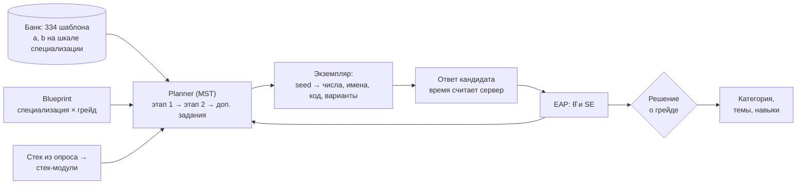

# Механика тестирования

## 1. Задача и выбранный подход

Тест должен определить грейд так, чтобы результаты разных кандидатов были сопоставимы, а задания не теряли силу после того, как их перескажут в чате. Два очевидных решения не подходят:

- **единый набор заданий** утекает: после первой волны кандидатов ключи ответов гуляют по рынку;
- **уникальные задания от нейросети** не утекают, но их сложность неизвестна, и результаты двух кандидатов несопоставимы.

ITScout использует третий путь:

> **калиброванный банк параметризованных шаблонов + двухэтапный адаптивный тест по blueprint + оценка на общей IRT-шкале специализации.**



## 2. Шаблон задания

**Шаблон** — семейство изоморфных заданий: одна проверяемая идея и одна сложность, но параметры (числа, имена, таблицы, фрагменты кода, порядок и состав дистракторов) генерируются для каждой попытки из seed. Параметры IRT (дискриминация `a`, сложность `b`, для заданий с выбором — угадывание `c = 1/k`) задаются на уровне шаблона.

```yaml
# backend/content/templates/backend/databases.yaml
- id: be.db.where_vs_having
  specializations: [backend]
  topic: databases
  skills: [sql]
  kind: single_choice
  irt: {a: 1.1, b: -0.9}
  params:
    table: {choice: [orders, payments, invoices, shipments]}
    key: {choice: [customer_id, region_id, manager_id, store_id]}
    total: {int: [10000, 90000], step: 5000}
  stem: >-
    Нужно вывести {{key}}, у которых сумма amount в таблице {{table}} больше {{total}}:
    SELECT {{key}}, SUM(amount) FROM {{table}} GROUP BY {{key}} … Где правильно разместить условие
    SUM(amount) > {{total}}?
  options:
    correct: ["В HAVING после GROUP BY"]
    wrong: ["В WHERE перед GROUP BY", "В ORDER BY", "В условии ON соединения", "В LIMIT"]
```

Для вычисляемых заданий («что выведет код», расчёт пула соединений, RPS, сложности) шаблон ссылается на Python-генератор в `testing/engine/generators`: он строит сниппет из seed и вычисляет верный ответ детерминированно, без `exec`. Дистракторы — типичные ошибки (off-by-one, мутабельный аргумент по умолчанию, порядок вычисления).

**Банк на MVP:** 334 шаблона (328 активных, 6 пилотных) по пяти специализациям: backend — 106, frontend — 76, devops — 53, data — 52, qa — 47 (часть шаблонов общая для нескольких специализаций).

| Вид задания | Шаблонов |
|---|---|
| выбор одного варианта | 142 |
| выбор нескольких вариантов | 63 |
| «что выведет код» | 56 |
| числовой ответ | 48 |
| упорядочивание шагов | 16 |
| открытый вопрос о подходе | 9 |

Формат и валидатор шаблонов — `backend/content/templates/README.md`; тест в CI (`validate_bank`) рендерит каждый шаблон на 25 seed'ах и проверяет детерминированность, число вариантов и ключ.

## 3. Blueprint и сборка теста

**Blueprint** задаёт, сколько заданий брать из каждой темы специализации (`backend/content/blueprints.yaml`):

| Специализация | Темы и квоты (18 оценённых заданий) |
|---|---|
| backend | HTTP и API 3, базы данных 3, конкурентность 2, архитектура 2, язык и фреймворк 4, алгоритмы 2, тестирование 1, безопасность 1 |
| frontend | веб-платформа 3, JavaScript и TypeScript 3, фреймворк 4, HTTP и API 2, производительность 2, тестирование 1, архитектура 1, алгоритмы 2 |
| qa | тест-дизайн 4, тестирование API 3, стек 3, SQL 2, процессы 2, нагрузочное 2, веб и мобильные 2 |
| devops | Linux 3, контейнеры 3, CI/CD 3, сети 3, мониторинг 2, облака и IaC 2, безопасность 2 |
| data | статистика 3, машинное обучение 4, стек 3, SQL 3, инженерия данных 2, метрики и эксперименты 3 |

Тема «Язык и фреймворк» собирается из **стек-модулей** по ответам опроса: для backend это python, java, go, csharp, nodejs, для frontend — react, vue, angular. Если для стека кандидата нет шаблонов, квота темы переходит к другим темам.

**Двухэтапный адаптивный тест (MST)** — проще и устойчивее полного CAT и точнее всего у порога грейда, где и принимается решение:

1. **Этап 1** — 9 заданий со сложностью около порога `cut_G` выбранного грейда, пропорционально квотам тем.
2. **Этап 2** — ещё 9 заданий. Если по этапу 1 θ̂ ≥ cut_G + 0,3 — блок около порога следующего грейда (распознать уверенный проход); если θ̂ < cut_G − 0,3 — блок между порогом предыдущего грейда и cut_G; иначе — у cut_G.
3. **Доп. задания** — пока |θ̂ − cut_G| < SE, добавляется до 4 заданий у порога.
4. **Пилотные слоты** — 2 неоцениваемых задания из шаблонов в статусе `pilot` (кандидат их не отличает); ответы копятся для калибровки.
5. **Открытый вопрос о подходе** — для Middle и выше, в θ̂ не входит (раздел 6).

Итого около 20 оценённых заданий и примерно 25 минут: одно задание на экран, у каждого свой лимит времени, вернуться назад нельзя. В демо-режиме (`TEST_MODE=short`) тест сокращён до 4 + 4 + до 2 доп. заданий.

**Отбор шаблона внутри темы** (`engine/session.py`): кандидаты — активные шаблоны темы, ещё не показанные в этой попытке, со сложностью в окне ±0,6 логита от цели (окно расширяется, если шаблонов мало). Вероятность выбора ∝ exp(−((b − цель)/окно)²) / (1 + 10·доля показов): ближе к цели и реже показанные шаблоны вероятнее. Шаблоны с долей показов выше 25% исключаются, пока в теме есть другие. Темы не идут подряд, если есть выбор. Варианты ответов перемешиваются.

## 4. Оценка способности и решение о грейде

Все шаблоны специализации лежат на **одной IRT-шкале**, поэтому кандидаты, получившие разные задания, получают сопоставимые оценки.

- **Модель ответа:** 2PL, для заданий с выбором — 3PL с c = 1/k:
  `P(верно | θ) = c + (1 − c) / (1 + exp(−a·(θ − b)))`. Ответ оценивается 0 или 1: выбор нескольких вариантов и упорядочивание засчитываются только при полном совпадении, числовой ответ — с допуском.
- **Оценка θ̂ — EAP** (expected a posteriori) с априорным N(0, 1) на сетке из 81 точки от −4 до 4; SE — апостериорное стандартное отклонение (`engine/irt.py`).
- **Пороги грейдов** на шкале специализации: intern −1,8, junior −0,8, middle 0,2, senior 1,2. Ниже порога стажёра категория не присваивается. Стартовые значения задаются экспертно; окончательные выводятся процедурой **modified Angoff**: эксперты оценивают, с какой вероятностью «минимально компетентный» кандидат грейда решит каждый шаблон, и порог — это θ, при котором ожидаемый балл по банку совпадает с суммой этих оценок.
- **Решение по тесту на грейд G:**

| Исход | Условие | Что дальше |
|---|---|---|
| не пройден | θ̂ < cut_G | предлагается тест на грейд ниже |
| пройден | θ̂ ≥ cut_G | категория «специализация × G» |
| пройден уверенно | θ̂ − SE ≥ cut_G и θ̂ ≥ cut_{G+1} − SE | категория G и предложение сразу сдать тест на G+1 |

- **Разбор по темам** — доля верных по каждой теме (описательно, для объяснений и карточки). **Навык «проверен тестом»**, если по нему ≥ 2 оценённых задания и ≥ 70% верно — это значение получает навык в подборе.
- **Перцентиль в категории** пересчитывается при появлении новых результатов.

### Правила смены грейда

| Ситуация | Правило |
|---|---|
| Калибровка (категории ещё нет) | цепочка тестов вниз или один раз вверх без ожидания, не больше одной попытки на грейд |
| Не прошёл тест на грейд G | повтор на G — не раньше чем через 30 дней |
| Повышение при действующей категории | не чаще раза в 90 дней; неудача не понижает текущий грейд |
| Срок действия результата | 12 месяцев, затем «требует подтверждения» и сниженная свежесть |

Интервалы — настройки `GRADE_CHANGE_COOLDOWN_DAYS`, `FAILED_GRADE_RETRY_DAYS`, `CATEGORY_VALID_DAYS` (`backend/app/core/config.py`). Грейд и категорию определяет **только тест**: ни резюме, ни LLM, ни регулярные задания их не меняют.

## 5. Устойчивость к распространению заданий

| Угроза | Защита в продукте | Как проверено |
|---|---|---|
| Утечка конкретных вопросов и ответов | Параметризация: у каждой попытки свои числа, имена, код, данные и состав вариантов — ключ из чужой попытки не подходит. Выучить шаблон значит выучить концепцию | у двух попыток в среднем 62,5% общих шаблонов, но 1,1% общих экземпляров |
| Слив пула вопросов | Банк из 334 шаблонов, случайный отбор в окне сложности, контроль экспозиции | при утечке 30% шаблонов вместе с 50 экземплярами каждого доля ложно прошедших Middle растёт с 15% до 25%; у фиксированного теста — с 15% до 64% |
| Подбор к адаптивности | Без параметризации адаптивный тест защищает не лучше фиксированного — поэтому параметризация обязательна | адаптивный тест без параметризации: 15% → 61% |
| Подсказчик и поиск в интернете | Лимит времени на задание считается на сервере (ответ после срока не засчитывается), одно задание на экран без возврата, копирование и контекстное меню в тексте задания отключены, уходы со вкладки фиксируются в `flags` попытки и видны как флаг, но не валят тест | — |
| Перебор попыток | Интервалы между попытками (30 и 90 дней), новый seed на каждую попытку | — |
| Пополнение банка | LLM пишет черновики шаблонов → ревью человеком → статус `pilot` (неоцениваемые слоты) → калибровка → `active`. LLM не выдаёт задания кандидатам напрямую | восстановление b по 400+ ответам: RMSE 0,17 |
| Устаревание шаблона | Статистика показов и верных ответов по каждому шаблону копится в `template_stats` — основа для мониторинга дрейфа (шаблон «стал легче» при том же θ → `retired`) | автоматический вывод из ротации — после MVP |

Подробные цифры и графики — [validation.md](validation.md) и [отчёт валидации](validation/report.md), раздел 7.

## 6. Открытый вопрос о подходе

Для Middle и выше тест заканчивается вопросом «как бы вы спроектировали X / нашли причину Y», ответ до 1500 символов. Он **не входит в θ̂**, чтобы шумная оценка не смешивалась с калиброванной шкалой: категорию определяют только оценённые задания.

Оценка подхода устроена одинаково для открытого вопроса и регулярных заданий «предложите подход» (§11 ТЗ на реализацию): LLM (температура 0) только отмечает в ответе критерии из **чек-листа** (4–6 бинарных пунктов), итог — доля отмеченных критериев, его считает код; без LLM — оценка работодателя 1–5. Результат хранится отдельно как `approach` и входит в силу профиля внутри категории с весом 0,10.

Оценка выставляется сразу при ответе на открытый вопрос. Работодатель видит в карточке кандидата вопрос, ответ (до раскрытия контактов — без email, телефонов и ссылок) и отметки по каждому критерию. Если LLM выключен, ответ сохраняется без оценки, а тест работает полностью.

## 7. Тест под вакансию

Экран работодателя «Проверка под вакансию» показывает, как из описания вакансии получается тест (`testing/engine/vacancy.py`, `POST /vacancy-tests/preview`):

1. текст вакансии разбирается в требования (словарь, LLM только дополняет);
2. веса тем blueprint'а смещаются: каждый обязательный навык добавляет 2 к весу своей темы, желательный — 1, затем веса снова делятся на прежнее число заданий методом наибольшего остатка; стек-модули выбираются по навыкам вакансии;
3. показываются 3 примера заданий из самых усиленных тем со сложностью у порога грейда вакансии; «Сгенерировать заново» даёт другие экземпляры тех же шаблонов той же сложности. **Ключи ответов не передаются даже работодателю**;
4. для навыков без шаблонов LLM предлагает черновики в статусе `pilot` с пометкой «не влияют на оценку до калибровки».

Демо-набор — 4 вакансии (Backend Middle на Python, Frontend Junior на React, QA Middle, DevOps Senior) в `backend/content/demo_vacancies/`.

## 8. Где в коде

| Что | Файл |
|---|---|
| Загрузка банка и blueprint'ов, валидатор | `backend/app/modules/testing/engine/bank.py` |
| Рендер экземпляра по seed, генераторы | `engine/render.py`, `engine/generators/` |
| MST, отбор шаблонов, решение о грейде | `engine/session.py` |
| EAP, информационная функция | `engine/irt.py` |
| Проверка ответов | `engine/scoring.py` |
| Попытки, время, флаги, статистика шаблонов | `backend/app/modules/testing/service.py` |
| Правила смены грейда, перцентили | `backend/app/modules/categories/` |
