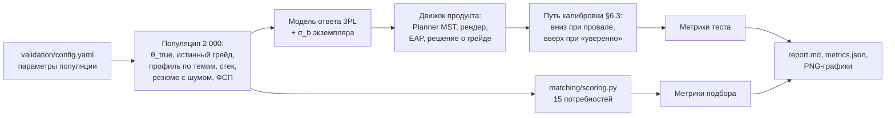

# Процедура валидации и результаты

Валидация проверяет критерии ТЗ к тестированию и подбору — согласованность, дискриминативность, соответствие эталону, устойчивость к утечке заданий, корректность категоризации и качество выдачи — **на том же коде, что работает в продукте**. Полный отчёт с таблицами и графиками генерируется командой `make validate` в [`docs/validation/report.md`](validation/report.md), сырые метрики — [`docs/validation/metrics.json`](validation/metrics.json). Здесь — устройство процедуры и главные результаты (seed 2026, 2 000 кандидатов, 7 276 попыток теста).

## 1. Как устроена процедура



- **Тот же движок.** Тест собирается и оценивается кодом `backend/app/modules/testing/engine`, подбор — `matching/scoring.py`, специализация по опросу — `survey.service.score_specializations`. БД и HTTP не участвуют, прогон детерминирован по seed.
- **Популяция.** 2 000 синтетических кандидатов по 5 специализациям. У каждого — истинная способность θ_true (смесь распределений по грейдам), истинный грейд — старший грейд, чей порог не выше θ_true, профиль по темам (отклонения σ = 0,3 от θ), истинный стек, резюме с шумом (лишние и пропущенные навыки), заявленный грейд с ошибкой (20% завышают, 10% занижают), история ФСП у 35%.
- **Модель ответа.** 3PL от способности по теме задания плюс отклонение сложности конкретного экземпляра (σ_b = 0,15). Движок о профиле по темам и σ_b не знает — это проверка устойчивости к нарушению его модели.
- **Путь кандидата.** Тест на заявленный грейд, вниз при провале, один раз вверх при «пройден уверенно». Для согласованности каждый проходит путь дважды с разными seed — другие шаблоны и экземпляры.
- **Подбор.** 15 потребностей (по 3 на специализацию). Истинная релевантность 0–3 строится только из истинных специализации, грейда и стека; сравниваются выдача ITScout и базовые линии.

## 2. Главные результаты

| Свойство (критерий ТЗ) | Метрика | Значение |
|---|---|---|
| Соответствие эталону | Категория совпала с истинным грейдом | **81,2%** |
|  | Ошибка больше чем на один грейд | **0,0%** |
|  | Решение «пройден / не пройден» по одному тесту | 84,2% |
| Согласованность | Повторная калибровка на других заданиях: та же категория | 75,7% (взвешенная κ = **0,88**) |
|  | Повтор решения «пройден / не пройден»; вдали от порога (> 0,5) | 78,5%; 89,3% |
|  | Корреляция θ̂ двух попыток | 0,84 |
| Точность оценки | RMSE θ̂ / корреляция с истинным θ | 0,48 / 0,91 |
| Длина теста | Оценённых заданий в попытке | 19,6 (18–22) |
| Дискриминативность | Медианная точечно-бисериальная корреляция шаблона с θ̂; шаблонов с r < 0,1 | 0,39; 0% |
| Защита от утечки | Общих шаблонов / общих экземпляров у двух попыток | 62,5% / **1,1%** |
|  | Слито 30% ключей: доля ниже Middle, прошедших тест на Middle | фиксированный тест 15% → 64%; **ITScout 15% → 25%** |
| Сопоставимость форм | Макс. расхождение среднего θ̂ между стек-модулями | 0,09 логита |
|  | Точность категории при σ_b экземпляров от 0 до 0,5 | 80,1–80,7% (в пределах погрешности) |
| Калибровка | RMSE восстановления b шаблонов по 400+ ответам | 0,17 |
| Категоризация | Специализация по опросу (топ-1 / топ-2) | 97,2% / 99,7% |
| Подбор | P@5: выдача ITScout / категория по тесту + ключевые слова / ключевые слова резюме | 0,68 / 0,80 / 0,29 |

## 3. Соответствие эталону и согласованность

Ошибки категоризации — только соседние грейды: это кандидаты, чья способность лежит у порога, где погрешности измерения хватает, чтобы оказаться по другую сторону. Вдали от порогов категория повторяется в 84,7% случаев, решение «пройден / не пройден» — в 89,3%.


## 4. Дискриминативность и точность

Информационная функция теста максимальна около порогов Middle и Senior, где принимается решение. У нижних порогов (Intern, Junior) банку не хватает лёгких заданий — это видно и по точности: больше всего ошибок на уровнях «нет категории» и Intern.


## 5. Устойчивость к утечке

Сценарий: 400 кандидатов ниже Middle сдают тест на Middle, 30% ключей слиты. Для фиксированного теста слиты 30% ответов единой формы; для ITScout — 30% шаблонов банка вместе с 50 экземплярами каждого.

| Сценарий | Прошли тест | Завышение θ̂ |
|---|---|---|
| Фиксированный тест, честно | 15,0% | 0,00 |
| Фиксированный тест, утечка | 64,2% | 0,64 |
| Адаптивный тест без параметризации, утечка | 61,0% | 0,67 |
| ITScout с параметризацией, утечка | 25,2% | 0,18 |

Сами по себе банк и адаптивность от утечки не защищают — защищает параметризация шаблонов. Прирост ложно прошедших: 49 п.п. у фиксированного теста против 10 п.п. у ITScout.


## 6. Подбор

| Способ ранжирования | P@5 | P@10 | nDCG@10 | перерост@10 |
|---|---|---|---|---|
| ITScout: выдача по категориям (по умолчанию) | 0,68 | 0,65 | 0,77 | 9% |
| ITScout: «общий топ» по score | 0,49 | 0,49 | 0,67 | 29% |
| категория по тесту + ключевые слова | 0,80 | 0,79 | 0,88 | 7% |
| заявленный грейд + ключевые слова | 0,71 | 0,66 | 0,80 | 9% |
| только ключевые слова резюме | 0,29 | 0,27 | 0,45 | 26% |

1. **Тест как фильтр точнее резюме:** категория по тесту + ключевые слова даёт P@5 0,80 против 0,71 у заявленного грейда и 0,29 у одних ключевых слов.
2. **Выдача ITScout** в 2,3 раза точнее ключевых слов, но ниже варианта «категория + ключевые слова»: внутри категории score упорядочивает по силе подтверждённого профиля (θ̂, ФСП, свежесть), а синтетическая истина знает только специализацию, грейд и стек и за силу профиля не поощряет. Правильность порядка внутри категории проверяет экспертная разметка (раздел 8).
3. **«Общий топ»** хуже группировки: соседний грейд теряет на категории лишь 6 из 100 баллов, и сильный кандидат соседнего грейда обгоняет точного. Поэтому группировка по категориям — режим по умолчанию.


## 7. Слабые места и что с ними делать

Пороги, blueprint'ы, веса и движок по итогам прогона **не менялись автоматически** — рекомендации отчёта:

| Наблюдение | Рекомендация |
|---|---|
| Трёхуровневое решение (не / пройден / уверенно) повторяется в 61% | показывать «уверенно» как предложение попробовать грейд выше, а надёжность оценивать по итоговой категории; повторяемость растёт от доп. заданий у порога cut_{G+1} |
| Порог экспозиции 25% недостижим: нужно ≥ 79 активных шаблонов на специализацию, у qa — 45 | довести банк до ≥ 79 шаблонов на специализацию или считать порог относительно размера банка |
| У 33% шаблонов мало различных экземпляров | расширить пулы параметров у самых уязвимых шаблонов (список — в отчёте, раздел 7) |
| «Общий топ»: 29% топ-10 — кандидаты старше нужного грейда | усилить штраф соседнего грейда `category_fit.adjacent_grade` в `content/matching.yaml` (сейчас 0,6) |
| Мало заданий у крайних порогов | добавить по 8–10 шаблонов с b от −2,2 до −1,0 и 4–6 с b выше 1,4 на специализацию |

## 8. Что не измерено автоматически

- **Реальная калибровка.** Симуляция проверяет механику при заданной модели ответов; параметры шаблонов на живых людях уточняются через пилотные слоты (≈ 400 ответов на шаблон до статуса `active`).
- **Пороги грейдов** — стартовые экспертные значения; окончательные задаются процедурой modified Angoff.
- **Экспертная оценка подбора.** План: участник команды и 2–3 приглашённых ИТ-специалиста размечают 100 пар «потребность — карточка кандидата» по шкале 0–3 → корреляция Спирмена с ранжированием ITScout и P@5. Функции метрик готовы (`validation/stats.py`), разметка требует людей.
- **Разбор резюме** (precision и recall полей), открытый вопрос о подходе и поведенческие сигналы (уход со вкладки, время ответа) в симуляции не участвуют.

## 9. Воспроизведение

```bash
make validate                                         # Linux, WSL, CI; ~3–4 минуты
cd backend && uv run python ../validation/run.py      # то же без make
cd backend && uv run python ../validation/run.py --size 500 --seed 7 --out /tmp/v   # другой прогон
```

Smoke-тест процедуры на маленькой популяции (`backend/tests/test_validation.py`) проверяет в CI, что метрики считаются и детерминированы.
