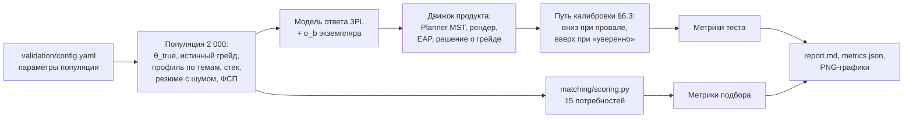

# Процедура валидации и результаты

Валидация проверяет критерии ТЗ к тестированию и подбору — согласованность, дискриминативность, соответствие эталону, устойчивость к утечке заданий, корректность категоризации и качество выдачи — **на том же коде, что работает в продукте**. Полный отчёт с таблицами и графиками генерируется командой `make validate` в [`docs/validation/report.md`](validation/report.md), сырые метрики — [`docs/validation/metrics.json`](validation/metrics.json). Здесь — устройство процедуры и главные результаты (seed 2026, 2 000 кандидатов, 7 253 попыток теста).

## 1. Как устроена процедура



- **Тот же движок.** Тест собирается и оценивается кодом `backend/app/modules/testing/engine`, подбор — `matching/scoring.py`, специализация по опросу — `survey.service.score_specializations`. БД и HTTP не участвуют, прогон детерминирован по seed.
- **Популяция.** 2 000 синтетических кандидатов по 5 специализациям. У каждого — истинная способность θ_true (смесь распределений по грейдам), истинный грейд — старший грейд, чей порог не выше θ_true, профиль по темам (отклонения σ = 0,3 от θ), истинный стек, резюме с шумом (лишние и пропущенные навыки), заявленный грейд с ошибкой (20% завышают, 10% занижают), история ФСП у 35%.
- **Модель ответа.** 3PL от способности по теме задания плюс отклонение сложности конкретного экземпляра (σ_b = 0,15). Движок о профиле по темам и σ_b не знает — это проверка устойчивости к нарушению его модели.
- **Путь кандидата.** Тест на заявленный грейд, вниз при провале, один раз вверх при «пройден уверенно». Для согласованности каждый проходит путь дважды с разными seed — другие шаблоны и экземпляры.
- **Подбор.** 15 потребностей (по 3 на специализацию). Истинная релевантность 0–3 строится только из истинных специализации, грейда и стека; сравниваются выдача ITScout и базовые линии.

## 2. Главные результаты

| Свойство (критерий ТЗ) | Метрика | Значение |
|---|---|---|
| Соответствие эталону | Категория совпала с истинным грейдом | **81,7%** |
|  | Ошибка больше чем на один грейд | **0,0%** |
|  | Решение «пройден / не пройден» по одному тесту | 84,4% |
| Согласованность | Повторная калибровка на других заданиях: та же категория | 75,8% (взвешенная κ = **0,88**) |
|  | Повтор решения «пройден / не пройден»; вдали от порога (> 0,5) | 78,3%; 89,1% |
|  | Корреляция θ̂ двух попыток | 0,83 |
| Точность оценки | RMSE θ̂ / корреляция с истинным θ | 0,48 / 0,91 |
| Длина теста | Оценённых заданий в попытке | 19,6 (18–22) |
| Дискриминативность | Медианная точечно-бисериальная корреляция шаблона с θ̂ | 0,38 |
| Защита от утечки | Общих шаблонов / общих экземпляров у двух попыток | 42,3% / **0,1%** |
|  | Слито 30% ключей: доля ниже Middle, прошедших тест на Middle | фиксированный тест 14% → 70%; **ITScout 12% → 13%** |
| Экспозиция | Активных шаблонов на специализацию (нужно ≥ 79 для порога 25%) | 91–129 |
| Сопоставимость форм | Макс. расхождение среднего θ̂ между стек-модулями | 0,10 логита |
|  | Точность категории при σ_b экземпляров от 0 до 0,5 | 81,4–82,3% (в пределах погрешности) |
| Калибровка | RMSE восстановления b шаблонов по 400+ ответам | 0,16 |
| Категоризация | Специализация по опросу (топ-1 / топ-2) | 97,2% / 99,7% |
| Подбор (60 потребностей, ±0,06) | P@5: выдача ITScout / категория по тесту + ключевые слова / заявленный грейд + ключевые слова / ключевые слова резюме | 0,69 / 0,75 / 0,69 / 0,28 |

Банк заданий расширен по рекомендациям первого прогона: 517 активных шаблонов вместо 328 (≥ 91 на специализацию), лёгкие и трудные шаблоны у крайних порогов, числовые задания без угадывания у порога Intern, больше различных экземпляров у шаблонов с малой вариативностью. Эффект: доля ложно прошедших при утечке ключей — 13% вместо 25%, общих экземпляров у двух попыток — 0,1% вместо 1,1%, точность на уровне «нет категории» — 52% вместо 37%. Бенчмарк подбора расширен с 15 до 60 потребностей: на 15 потребностях P@5 колебался на ±0,07 от посторонних изменений.

## 3. Соответствие эталону и согласованность

Ошибки категоризации — только соседние грейды: это кандидаты, чья способность лежит у порога, где погрешности измерения хватает, чтобы оказаться по другую сторону. Вдали от порогов категория повторяется в 88,2% случаев, решение «пройден / не пройден» — в 89,1%.


## 4. Дискриминативность и точность

Информационная функция теста максимальна около порогов Middle и Senior, где принимается решение. У порогов Intern и Junior максимум смещён вправо: в заданиях с выбором ответа угадывание сдвигает максимум информации выше сложности задания, а самые лёгкие шаблоны лежат около −1,8. Поэтому больше всего ошибок — на уровнях «нет категории» и Intern.


## 5. Устойчивость к утечке

Сценарий: 400 кандидатов ниже Middle сдают тест на Middle, 30% ключей слиты. Для фиксированного теста слиты 30% ответов единой формы; для ITScout — 30% шаблонов банка вместе с 50 экземплярами каждого.

| Сценарий | Прошли тест | Завышение θ̂ |
|---|---|---|
| Фиксированный тест, честно | 14,2% | 0,01 |
| Фиксированный тест, утечка | 69,8% | 0,70 |
| Адаптивный тест без параметризации, утечка | 66,2% | 0,69 |
| ITScout с параметризацией, утечка | 13,2% | 0,02 |

Сами по себе банк и адаптивность от утечки не защищают — защищает параметризация шаблонов. Прирост ложно прошедших: 56 п.п. у фиксированного теста против 1 п.п. у ITScout. Медианная вероятность того, что экземпляр задания совпадёт с одним из 50 слитых, — 3,0%.


## 6. Подбор

60 потребностей (по 12 на специализацию), погрешность P@5 — ±0,06 (95%).

| Способ ранжирования | P@5 | P@10 | nDCG@10 | перерост@10 |
|---|---|---|---|---|
| ITScout: выдача по категориям (по умолчанию) | 0,69 | 0,64 | 0,80 | 5% |
| ITScout: «общий топ» по score | 0,69 | 0,63 | 0,79 | 6% |
| категория по тесту + ключевые слова | 0,75 | 0,77 | 0,86 | 8% |
| заявленный грейд + ключевые слова | 0,69 | 0,69 | 0,80 | 8% |
| только ключевые слова резюме | 0,28 | 0,27 | 0,47 | 31% |

1. **Тест как фильтр точнее резюме:** категория по тесту + ключевые слова даёт P@5 0,75 против 0,69 у заявленного грейда и 0,28 у одних ключевых слов.
2. **Перерос грейд — штраф.** На 60 потребностях выяснилось, что при прежних весах (навыки 0,30, сила профиля 0,30) сильный кандидат категории, по тесту уже уровня следующего грейда, вытеснял из топа точное совпадение: P@5 0,62–0,65, в «общем топе» 0,58–0,60. Теперь вес полноты стека выше (0,40 / 0,20), а за порогом следующего грейда сила профиля штрафуется и в объяснении появляется предупреждение. Внутри грейда более сильный по тесту по-прежнему выше. Итог: P@5 0,69 в обоих режимах, nDCG@10 0,80, переросших в топ-10 — 5–6%. Блок «Вне фильтров» на результат не влияет.
3. **Остаток до варианта «категория + ключевые слова»** (0,69 против 0,75) — это ФСП, свежесть и условия в score: синтетическая истина их не учитывает, а продукт учитывает намеренно. Какой порядок полезнее работодателю, решает экспертная разметка (раздел 8).


## 7. Слабые места и что с ними делать

Пороги, blueprint'ы, веса и движок по результатам прогона **автоматически не меняются** — рекомендации отчёта (раздел 11):

| Наблюдение | Рекомендация |
|---|---|
| Трёхуровневое решение (не / пройден / уверенно) повторяется в 62% | показывать «уверенно» как предложение попробовать грейд выше, а надёжность оценивать по итоговой категории; до 8 доп. заданий у порога дают повтор категории 78% вместо 75% |
| Выше порога экспозиции 25% — до 19% шаблонов отдельных тем (data) | пополнять темы с самой большой квотой шаблонами около порогов Junior и Middle |
| Максимум информации теста на Intern смещён от порога (−0,9 при пороге −1,8) | числовые задания без угадывания уже добавлены (точность на уровне «нет категории» 37% → 52%); дальше — ещё такие задания с b около −2 |
| Порядок внутри категории: P@5 0,69 против 0,75 у «категория + ключевые слова» | экспертная разметка пар «потребность — кандидат» до дальнейших изменений весов |

## 8. Что не измерено автоматически

- **Реальная калибровка.** Симуляция проверяет механику при заданной модели ответов; параметры шаблонов на живых людях уточняются через пилотные слоты (≈ 400 ответов на шаблон до статуса `active`).
- **Пороги грейдов** — стартовые экспертные значения. Процедура modified Angoff реализована (вкладка «Пороги (Angoff)» на `/expert`): эксперт оценивает 12 заданий у каждой границы грейда — с какой вероятностью их решит минимально компетентный кандидат, — и порог эксперта — θ, где ожидаемый балл по набору равен сумме его оценок. Продукт считает рекомендуемый порог (среднее ± SE) против действующего (`GET /expert/angoff/summary`); пороги сами не меняются. Порядок — `docs/implementation.md` §12.4; результаты внесём сюда после экспертной сессии.
- **Экспертная оценка подбора.** Участник команды и 2–3 приглашённых ИТ-специалиста размечают пары «потребность — карточка кандидата» по шкале 0–3 на экране `/expert` (регистрация по коду-приглашению). Пары — объединение топ-6 выдачи ITScout и топ-6 поиска по ключевым словам для 10 потребностей разных специализаций; эксперт не видит score и место в выдаче. Итоги считает сам продукт (`GET /expert/summary`): P@5 обеих выдач на экспертных оценках, корреляция Спирмена score со средней оценкой, точное совпадение и взвешенная κ между экспертами. Порядок — `docs/implementation.md` §12.4; результаты внесём сюда после разметки.
- **Разбор резюме** (precision и recall полей), открытый вопрос о подходе и поведенческие сигналы (уход со вкладки, время ответа) в симуляции не участвуют.

## 9. Воспроизведение

```bash
make validate                                         # Linux, WSL, CI; ~7–8 минут
cd backend && uv run python ../validation/run.py      # то же без make
cd backend && uv run python ../validation/run.py --size 500 --seed 7 --out /tmp/v   # другой прогон
```

Smoke-тест процедуры на маленькой популяции (`backend/tests/test_validation.py`) проверяет в CI, что метрики считаются и детерминированы.
